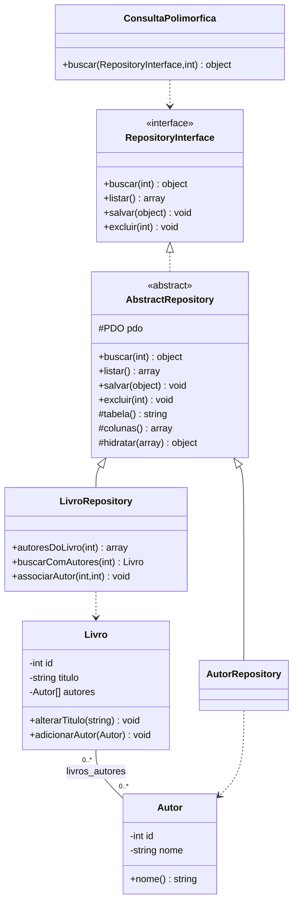

# BibliotecaORM — Avaliação Prática de Programação II

**UNOESC | Ciência da Computação | Professor: Leandro Otavio Cordova Vieira**

Mini-ORM **próprio** em PHP 8.2+, PDO e MySQL 8, sem Laravel, Doctrine ou outros ORMs. O projeto usa o padrão **Data Mapper**, com entidades separadas do SQL, repositórios especializados e um repositório abstrato para operações CRUD.

> A atividade avalia a camada de persistência e não exige interface web. Execute a demonstração pelo terminal.

## Requisitos

- PHP 8.2 ou superior com extensão `pdo_mysql`
- MySQL 8 com tabelas InnoDB
- Windows com PowerShell ou outro terminal PHP

## Como executar

No Windows, abra **`INICIAR_BIBLIOTECAORM.cmd`**. Digite o usuário e a senha do MySQL somente no seu computador. O iniciador:

1. Prepara os bancos `biblioteca_orm` e `biblioteca_orm_teste`.
2. Roda **5 testes de domínio** (não requerem banco).
3. Roda **13 testes de integração** usando banco isolado.
4. Executa as **7 evidências práticas** em `demo.php`.
5. Guarda a saída real em `evidencias/execucao-AAAAMMDD-HHMMSS.txt`.

**Não há log aprovado dos testes MySQL neste repositório**: para comprovar as integrações, é preciso executá-las em um MySQL autenticado e revisar a saída. A demonstração cria exemplos no banco principal; os testes de integração usam transações e rollback no banco separado.

### Execução manual

Configure as variáveis de ambiente `DB_HOST`, `DB_USER`, `DB_PASS` e `DB_NAME` em sua sessão do terminal, sem salvar senhas no Git.

```powershell
php preparar_bancos.php
php tests/domain.php
$env:DB_NAME='biblioteca_orm_teste'
php tests/smoke.php
$env:DB_NAME='biblioteca_orm'
php demo.php
```

Caso o PHP não carregue `pdo_mysql` por padrão, o iniciador Windows procura a extensão na pasta `ext` do PHP instalado.

## Arquitetura

```text
src/
  Domain/
    Livro.php
    Autor.php
  Infrastructure/
    RepositoryInterface.php
    AbstractRepository.php
    LivroRepository.php
    AutorRepository.php
    Conexao.php
  Application/
    ConsultaPolimorfica.php
sql/
  schema.sql
  schema_teste.sql
tests/
  domain.php
  smoke.php
```

- **Encapsulamento:** `Livro` e `Autor` têm atributos privados e validam nome, título e identidade.
- **Herança/abstração:** `AbstractRepository` centraliza `buscar`, `listar`, `salvar`, `excluir`; as subclasses informam mapeamento e hidratação.
- **Interface/polimorfismo:** `ConsultaPolimorfica::buscar(RepositoryInterface, int)` aceita os dois repositórios.
- **CRUD/hidratação:** `PDO` mapeia objetos para linhas e vice-versa, preservando IDs e tipos.
- **N:N:** a tabela `livros_autores` conecta dois ou mais autores a um livro; a coleção é recuperada em `buscarComAutores()`.
- **Segurança:** prepared statements, nomes de tabelas e colunas conhecidos pelo código, PKs/FKs e `rollBack()` em falhas.

## Evidências exigidas

| Nº | Requisito | Onde demonstrar |
|---|---|---|
| 1 | INSERT de Livro e dois Autores, com IDs do MySQL | `demo.php` — [1] |
| 2 | SELECT por ID e hidratação | `demo.php` — [2/4] |
| 3 | UPDATE e nova consulta | `demo.php` — [3] |
| 4 | Dois autores no mesmo Livro, sem duplicação | `demo.php` — [2/4] |
| 5 | Polimorfismo com `RepositoryInterface` | `demo.php` — [5] |
| 6 | Erro de FK e rollback | `demo.php` — [6] |
| 7 | DELETE e restrição referencial | `demo.php` — [7] |

A listagem `listar()` também é demonstrada no mesmo programa e exercitada nos testes.

## Diagrama de classes

Consulte [diagramas/diagrama_classes.mmd](diagramas/diagrama_classes.mmd), renderizado também abaixo:



## Relatório e entrega

O professor exige, **além do link do repositório**, um relatório técnico de 2 a 4 páginas em PDF com UML, decisões, evidências e limitações. O arquivo `Relatorio_Tecnico_BibliotecaORM_Aula11.pdf` foi preparado separadamente e deve ser anexado no portal junto com o link do GitHub. Não confunda o diagrama do README com a entrega obrigatória do relatório em PDF.

As limitações do mini-ORM incluem ausência de lazy loading, identity map, query builder, migrations, carregamento em lote e controle de concorrência. Uma execução repetida de `demo.php` insere novos exemplos no banco principal.

Projeto acadêmico individual: é necessário compreender e saber explicar o funcionamento, não apenas entregar os arquivos. Não publique senhas reais nem dados pessoais de terceiros.
